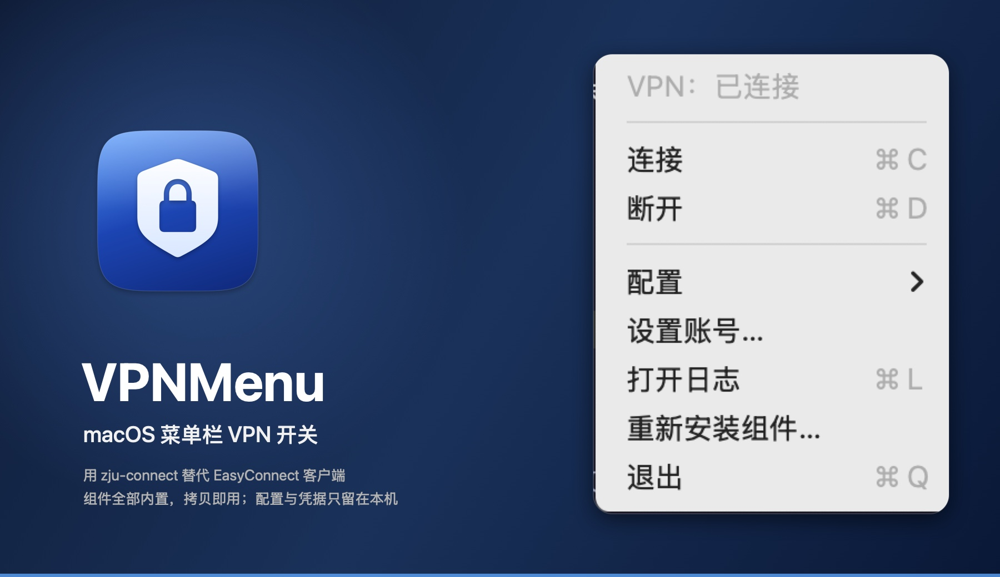
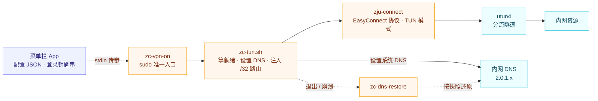

<div align="center">


# VPNMenu

macOS 菜单栏 VPN 开关 · 用 zju-connect 替代 EasyConnect 客户端

[](./LICENSE)
[](#构建)
[](#构建)
[](src/main.swift)
[](https://github.com/Mythologyli/zju-connect)
[](https://github.com/lcssos/vpnmenu)



</div>

菜单栏常驻，点一下就能连接/断开。**所有运行组件都在 App 内部**，拷贝到另一台 Mac 的
`/Applications` 后，首次连接输一次管理员密码即可使用，不再需要装 EasyConnect 客户端。

**本仓库不含任何公司内网信息**：服务器地址、域名路由、账号密码都不在源码或 App 包里，
配置保存在使用者本机（见「配置与隐私」）。

## 特性

- **菜单栏一键开关**：连接 / 断开 / 切换配置都在菜单里完成，不用切窗口。
- **启动即连、退出即断**：本机只有一个配置时，打开 App（包括登录自启）会自动连接；
  退出时先断开隧道再退出。
- **开箱即用**：zju-connect、TUN 脚本、sudoers 安装逻辑全部打包进 `VPNMenu.app`。
- **单实例**：重复启动（登录自启与手动打开撞在一起、直接运行二进制）时，后一个进程
  直接退出，不会出现多个菜单栏图标，也不会动已有隧道。
- **凭据不落盘**：账号密码存登录钥匙串，通过 stdin 交给 root 脚本；密码不落盘、不进 `ps`
  （用户名会作为 zju-connect 的 `-username` 参数出现在进程列表里）。
- **多配置**：导入 / 导出 JSON，已连接时切换会自动重连。
- **实现可切换**：系统 DNS 和多线路选线默认由 App 内的脚本完成（连接更快）；配置里把
  `dnsMode` / `multiLine` 设为 `zju` 可切回 zju-connect 的实现。
- **崩溃兜底**：系统 DNS 由启动脚本按需接管（只改有 IP 的网络服务），异常退出后按快照还原。
- **网络切换自动恢复**：Wi‑Fi / 有线切换后自动断开重连，并把系统 DNS 按新网络重新设置。
- **轻量常驻**：稳态下只做 `kill(0)` 检查，不 fork 子进程；配置变化时才重新解析。
- **通用二进制**：同一份 App 在 Intel 与 Apple Silicon 上原生运行，无需 Rosetta。

## 为什么选择 VPNMenu

| | EasyConnect | 原版 zju-connect | VPNMenu |
|---|---|---|---|
| 形态 | 厂商客户端 + 后台守护进程 | CLI 工具 | 菜单栏 App，无常驻守护进程 |
| 连接操作 | 打开客户端登录 | 手敲一长串参数 | 菜单栏点一下，⌘C / ⌘D |
| 状态反馈 | 客户端窗口 | 看日志 | 图标：空心锁 / 实心锁 / 交替动画 |
| 配置与多环境 | 客户端管理 | 自己记命令 | JSON 配置，多套切换、导入导出 |
| 凭据 | 客户端保存 | 环境变量或参数 | 登录钥匙串，经 stdin 传递；密码不进 `ps` |
| 提权范围 | 整套后台组件 | 自己 `sudo` | sudoers 只放行启停两个脚本 |
| 崩溃后的 DNS | 厂商负责 | 可能留在 `2.0.1.x` | 按快照还原，App 自动修复 |
| 安装 / 卸载 | 安装器 | 自行下载二进制 | 拷贝 App / 删除 App |
| 源码 | 闭源 | 开源 | 开源（AGPL-3.0），脚本可审计 |

协议能力沿用 zju-connect，VPNMenu 补的是**日常使用体验与系统集成的安全边界**：不常驻后台、
最小提权、凭据不落盘、失败可恢复。代价是首次连接要输一次管理员密码（写 sudoers），
协议兼容性也取决于 zju-connect 上游；本项目与浙江大学、深信服均无隶属关系。

## 工作原理



紫框 = 普通用户空间（界面与配置），橙框 = root 侧（经 sudo 启动），青框 = 网络侧。
root 脚本只从 stdin 读白名单参数，不 `source`/`eval` 用户可写文件，sudoers 也不放行 shell。

### 状态与图标

| 状态 | 菜单栏图标 | 说明 |
|---|---|---|
| 未连接 | 空心锁 | 点击「连接」启动隧道 |
| 连接中 / 断开中 | 实心锁与空心锁每 0.7 秒交替 | 等待 utun 与路由就绪 / 等待进程退出；连接中可以点「断开」取消 |
| 已连接 | 实心锁 | 内网资源可访问 |

App 不做定时轮询，只在启动、连接/断开收尾、配置变更和网络变化回调时刷新状态：
读 `/var/run/zju-connect.pid` 并 `kill(0)` 判断隧道进程是否存活，全部在 App 内完成，
不启动子进程。命令行校验只在首次见到某个进程实例时做一次；之后用 `sysctl` 读取的
进程启动时间识别 PID 复用，所以稳态下没有额外 fork。

因此外部启停隧道或进程崩溃后，菜单栏文字不会自己更新；执行一次「断开」或其它会
收尾的操作后即刷新到实际状态。

“已连接”以 `/var/run/zju-connect.ready` 为准：包装脚本要等 utun 就绪、初始 `/32` 路由
写好后才会写入这个标记。认证失败或 utun 没出现时脚本会快速退出，不会先显示已连接。

### 切换 Wi-Fi / 网络后的恢复

zju-connect 的底层连接会绑在建立会话时的源地址上。Wi-Fi 从一个网络切到另一个之后，
进程、utun 和就绪标记都还在，但这条连接已经不可用；它自己的重拨还可能触发上游 panic。
因此：

- App 监听物理网卡（`en*` / 有线等，明确忽略 `utun*`）的 IPv4 与默认路由。变化稳定
  3 秒后自动执行「先断开再连接」，菜单显示“网络变化，正在重连…”，20 秒内最多触发一次。
- 每次刷新状态时也会比对一次网卡地址（`checkNow()`），作为 `NWPath` 事件的补充；
  App 不再定时轮询，所以这项兜底只在刷新发生的时机执行。
- `zc-tun.sh` 不做定时健康探测：启动完成后直接 `wait` zju-connect，进程退出立即
  清理并删除就绪标记。网络切换的判定交给 App。
- 用户手动点过「断开」后不会自动连回来；只有明确发起过连接、且隧道成功建立后，
  App 才把这份配置记为“期望保持连接”。

如果本机只有一份配置，App 启动约 1 秒后会自动连接；前提是凭据已保存在钥匙串、
sudoers 组件已安装，且当前没有活动隧道。缺凭据或未安装时静默跳过，不会在登录时弹窗。
菜单里的「退出并断开 VPN」会先停掉隧道再退出。

配置目录只在刷新时按需解析：目录 mtime 变化、首次扫描、距上次扫描超过 60 秒，或
通过菜单导入/删除时才重新读取并解码 JSON。

断开状态下发现系统 DNS 仍指向 VPN 地址（`2.0.1.x`）时，自动调用 `zc-vpn-off`
按启动前快照还原。断开时 `zc-tun.sh` 阻塞中的 `wait` 会被立即打断，不用等定时器。

## 目录

源码（进 git）：

```
src/main.swift          入口（CLI 辅助模式、单实例锁、启动菜单栏 App）
src/AppDelegate*.swift  菜单栏界面与业务（状态、连接/断开、配置、钥匙串、安装、退出）
src/Backends/           后端协议、注册表、通用 pidfile/ready 探针、zju-connect 实现
src/Profile.swift       配置模型、校验与本地存储
src/Keychain.swift      钥匙串凭据
src/Process.swift       外部命令执行
src/CommandLineTool.swift  命令行辅助模式
src/SingleInstance.swift   单实例锁
src/Info.plist          bundle 元信息（LSUIElement=true，CFBundleIconFile=VPNMenu）
runtime/vpn/            运行期脚本（zc-*.sh、install.sh、组件说明）
docs/profile.example.json  配置格式示例（占位值，可直接作为导入模板）
docs/images/            README 用的图标与示意图
docs/                   旧方案原理笔记（历史文档）
tools/build.sh          从源码组装通用 App
tools/deploy.sh         构建并部署到 /Applications
tools/make-icon.swift   生成 App 图标（1024px PNG → iconset → icns）
LICENSE                 本项目许可证（AGPL-3.0 全文）
THIRD-PARTY-NOTICES.md  第三方组件与许可声明（zju-connect 等）
licenses/               随 App 分发的第三方许可证原文
```

产物（不进 git，`tools/build.sh` 生成）：

```
build/                  中间产物（两个架构的 App 二进制、make-icon）
assets/                 图标产物（icon-1024.png、VPNMenu.iconset、VPNMenu.icns）
vendor/                 zju-connect 的 amd64/arm64 原件，用于合成通用二进制
package/VPNMenu.app     组装好的 App（部署/分发的来源）
dist/VPNMenu-<版本>.dmg 发布用磁盘映像（打开后拖进 /Applications）
dist/VPNMenu-<版本>.zip 压缩包，解压后拖进 /Applications
dist/SHA256SUMS         两个产物的 SHA-256
```

已安装的 `/Applications/VPNMenu.app` 是**部署产物**，不是原件：改东西请改 `src/` 和
`runtime/`，然后 `tools/build.sh` 重新组装并部署。

App 内部结构：

```
Contents/Resources/vpn/
  zju-connect            通用二进制（x86_64 + arm64）
  zc-tun.sh              启动 TUN、等就绪、注入路由并写就绪标记
  zc-vpn-on / -off       启停入口（sudoers 只放行这两个）
  zc-vpn-status          命令行状态查询（App 已改为进程内检查，脚本保留给排障）
  zc-dns-restore         按快照还原被 dns-hijack 改写的系统 DNS（崩溃兜底）
  install.sh             一次性安装：chown root、写 sudoers、清理旧组件
  uninstall.sh           撤销
  README.md              组件说明
Contents/Resources/licenses/AGPL-3.0.txt        第三方许可证原文
Contents/Resources/THIRD-PARTY-NOTICES.md       第三方组件声明
```

### 新增 VPN 后端

菜单、状态机、配置菜单和钥匙串都与具体后端无关。接入另一个「用户名密码 + TUN」类
后端时：

1. 在 `src/Backends/` 新建实现 `VPNBackend` 的文件，并注册到 `BackendRegistry.all`
2. 准备该后端的运行脚本目录，让 `tools/build.sh` 一起拷贝进 App 包
3. 配置 JSON 写 `"backend": "<id>"`；不写时视为 `zju-connect`

`AppDelegate.swift` 及其扩展不需要修改。状态检测复用 `ProcessFileProbe`（pidfile +
就绪标记）；如果新后端的就绪语义不同，在实现里自行判断即可。

## 关于 zju-connect

VPNMenu 只是一个菜单栏外壳，真正的 EasyConnect 协议实现来自
[zju-connect](https://github.com/Mythologyli/zju-connect)——一个用 Go 写的第三方开源
客户端（本项目使用 **v1.3.1**）。

- **用法**：App 以独立进程启动 App 包内的 `zju-connect`，通过 stdin 传连接参数，
  通过 TUN 接口建立分流隧道；不链接、不修改它的代码。系统 DNS 和多线路选线默认由
  `zc-tun.sh` 简化实现（更快）；配置里把 `dnsMode` / `multiLine` 设为 `zju` 可以
  切回 zju-connect 的实现。
- **来源**：`vendor/zju-connect-darwin-{amd64,arm64}` 是从上游 release 下载的官方
  二进制（这两个文件不进 git），`tools/build.sh` 只用 `lipo` 合并成通用二进制并重新签名。
- **许可证**：zju-connect 使用 **AGPL-3.0**，详见
  [THIRD-PARTY-NOTICES.md](THIRD-PARTY-NOTICES.md) 与
  [licenses/AGPL-3.0.txt](licenses/AGPL-3.0.txt)。
- **声明**：本项目与浙江大学、深信服科技股份有限公司均无隶属关系。zju-connect 是对
  EasyConnect 协议的独立实现，使用时请自行确认符合所在组织的网络与软件使用规定。

## 配置与隐私

配置与程序分离，**配置永远不进入 App 包，也不进 git**：

```
~/Library/Application Support/VPNMenu/profiles/<uuid>.json
```

一份配置只包含网络参数（不含账号密码）：

```json
{
  "schema": 1,
  "name": "公司 VPN",
  "server": "vpn.example.com",
  "port": 4430,
  "tunInterface": "utun4",
  "socksBind": "127.0.0.1:1090",
  "httpBind": "127.0.0.1:1091",
  "proxyDomains": ["legacy.example.com"],
  "domains": ["app.example.com", "db.example.com"],
  "dnsMode": "script",
  "multiLine": "script"
}
```

字段说明（`dnsMode` / `multiLine` 是**实现开关**，默认都走 App 内脚本；其余是网络参数）：

- `dnsMode`（实现开关）：系统 DNS 由谁实现。`script`（默认）由 `zc-tun.sh` 只改当前有
  IP 的网络服务；`zju` 用 zju-connect 的 `-dns-hijack`（启动时串行改所有服务，多等约
  10 秒）。
- `multiLine`（实现开关）：`script`（默认）不做线路 ping 测速，直接连配置的服务器；
  `zju` 由 zju-connect 登录后自动 ping 各线路选最优（多等约 2 秒）。
- `domains`：需要走隧道、且服务端 rclist 未下发 IP 的域名。连接后脚本用内网 DNS 解析，
  把结果注入 `/32` 路由；之后每 30 分钟重新解析刷新。
- `proxyDomains`：需要额外传给 zju-connect `-custom-proxy-domain` 的域名。
- `tunInterface` / `socksBind` / `httpBind` / `port` 可省略，默认 `utun4` /
  `127.0.0.1:1090` / `127.0.0.1:1091` / `4430`。

日常操作：

- 菜单栏 **配置 → 导入配置…**：选择一个 JSON，导入为新配置并选中；
- **配置 → 导出当前配置…**：导出一份不含凭据的 JSON，方便带到另一台电脑；
- **配置 → 删除当前配置…**：同时删除该配置在钥匙串里的账号密码；
- **配置 → 显示配置目录**：直接打开本机配置目录。

可以导入多份配置，菜单里用单选切换。已连接时切换会先断开再按新配置重连。

> 安全设计：root 脚本只从 App 的 **stdin** 接收白名单 `key=value` 并校验格式，
> 从不 `source`/`eval` 本机配置文件。用户可写的 JSON 不会被 root 当作代码执行。

## 凭据（不落盘，存钥匙串）

每个配置一份凭据，存在 macOS **登录钥匙串**，服务名
`com.lcssos.vpnmenu.credential.<配置 uuid>`：

- 首次连接某配置时如果钥匙串里没有，会弹框录入；之后可用菜单「设置账号…」修改；
- 连接时 App 从钥匙串取出，通过 **stdin** 传给 root 脚本（App 自身不把凭据放进 argv）；
  脚本再以 `ZJU_CONNECT_PASSWORD` 环境变量把密码交给 zju-connect，进程退出即消失；
  用户名则作为 `-username` 参数传入，因此 `ps` 里能看到用户名、看不到密码；
- 工程和 App 包内没有 `.pw`、用户名或密码；
- 从旧版本升级时，首次读取会把旧的全局条目 `com.lcssos.vpnmenu.credential`
  自动迁移到当前配置名下并删除旧条目。

命令行维护（可选）：

```bash
APP=/Applications/VPNMenu.app/Contents/MacOS/VPNMenu

# 导入配置并选中（会打印新配置 id）
$APP --import-profile ./work-vpn.json

# 列出本机配置（* 表示当前选中）
$APP --list-profiles

# 为当前选中的配置写入/覆盖凭据（stdin 两行：用户名、密码）
printf '%s\n%s\n' '用户名' '密码' | $APP --set-credential

# 用当前配置 + 钥匙串凭据直接连接（排障用）
$APP --vpn-on
```

> 注意：App 是 ad-hoc 签名，**重新签名/更新后首次读钥匙串会弹一次「允许访问」**，
> 点「始终允许」即可。钥匙串条目绑定的是二进制签名，不是明文。
>
> 卸载 App 不会自动删除钥匙串条目；需要的话在「钥匙串访问」里搜
> `com.lcssos.vpnmenu.credential` 删除，或运行
> `security delete-generic-password -s com.lcssos.vpnmenu.credential`。

## 构建

在仓库根目录执行：

```bash
tools/build.sh           # 只组装 package/VPNMenu.app
tools/build.sh --dist    # 同时打包 dist/VPNMenu-<版本>.zip 和 .dmg
```

脚本会分别交叉编译 x86_64 与 arm64，再用 `lipo` 合成通用二进制，并重新签名。
产物里两个 Mach-O 都是 `x86_64 + arm64`：

- `Contents/MacOS/VPNMenu`（App 本体）
- `Contents/Resources/vpn/zju-connect`（VPN 客户端）

所以同一个 `VPNMenu.app` 在 Intel 和 Apple Silicon 上都能原生运行，不需要 Rosetta。
想只出单一架构时，改 `tools/build.sh` 里保留其中一个 `swiftc -target` 即可。

图标重新生成见 `tools/make-icon.swift` 顶部注释（`make-icon` → `sips` → `iconutil`）。

## 部署 / 更新

```bash
tools/deploy.sh            # 部署现有产物
tools/deploy.sh --build    # 先构建再部署
```

脚本流程：`ditto` 覆盖 `/Applications/VPNMenu.app` → 跑 `install.sh`（chown root、
写 sudoers、停旧实例）→ 重启菜单栏进程；部署前若 VPN 是连接状态，会用本机配置和
钥匙串凭据自动恢复连接。会弹一次管理员密码。

也可以直接在菜单里点「重新安装组件…」。

## 分发

在仓库根目录执行：

```bash
tools/build.sh --dist
```

产物在 `dist/`：

- `VPNMenu-<版本>.dmg` —— 发布用磁盘映像，内含 App、`Applications` 快捷方式和
  `安装 VPNMenu.command`；
- `VPNMenu-<版本>.zip` —— 压缩包，解压后拖到 `/Applications`；
- `SHA256SUMS` —— 两个产物的 SHA-256，发布时一起上传。

首次安装可以把 `VPNMenu.app` 拖进「应用程序」，也可以双击 `安装 VPNMenu.command`
（若双击被 Gatekeeper 拦下，右键 →「打开」）。
**升级时请用安装脚本**：已安装的 App 归 `root:wheel` 所有（sudoers 安全边界），
Finder 以普通用户身份无法覆盖，直接拖动会报「必须跳过某些项目」。安装脚本会退出旧实例、
用管理员权限替换并重跑 `install.sh`。手动升级等价于：

```bash
sudo rm -rf /Applications/VPNMenu.app
# 再从 DMG 拖入（或 sudo ditto ...）
```

发布到 GitHub Releases 时把 dmg 和 `SHA256SUMS` 作为附件即可，source 归档由 tag 自动提供。

另一台 Mac：打开 DMG → 拖到「应用程序」→ 打开 → 导入配置 → 录入账号 →
首次连接时输入管理员密码。如提示「无法验证开发者」（下载带 quarantine）：

```bash
xattr -dr com.apple.quarantine /Applications/VPNMenu.app
```

压缩包里**不含配置**；把导出的 JSON 单独传过去即可。

## 安装后 App 之外还剩什么

- `/etc/sudoers.d/vpnmenu` —— 只允许当前用户免密执行 App 内的 `zc-vpn-on` / `zc-vpn-off`
- `/var/run/zju-connect.pid` —— 运行时 PID
- `/var/run/zju-connect.ready` —— 隧道就绪标记（退出时删除）
- `/var/run/zju-connect.dns.active` —— 当前设置的 VPN DNS（退出时删除）
- `~/Library/Logs/VPNMenu/zju-connect.log` —— 日志（超过 5MB 时轮转为 `.log.1`）
- `~/Library/Application Support/VPNMenu/profiles/` —— 本机配置（不进包、不进 git）
- `~/Library/Application Support/VPNMenu/instance.lock` —— 单实例锁（进程退出自动释放）
- `~/Library/LaunchAgents/com.lcssos.vpnmenu.plist` —— 登录自启（App 启动时自动维护路径）

## 已知坑

- **内网 DNS 地址不是固定的**：zju-connect 的虚拟 IP 每个会话可能是 `2.0.1.1` 或
  `2.0.1.2`，DNS 就监听在这个地址上。`zc-tun.sh` 从 utun 接口地址动态读取，不能写死。
  系统 DNS 只设置在**当前有 IP 的网络服务**上；切换网络后由自动重连流程重新设置。
- **网络切换会有约 10 秒中断**：检测到网卡地址/默认路由变化后要等 3 秒确认稳定，再断开
  重连；连续自动重连 3 次仍未稳定时会停止，需要手动点「连接」。
- **两层检测都依赖“旧源地址消失”**：同一台路由器的不同 SSID 分配了相同 IP、默认路由
  也没变时，签名不变；如果此时底层连接碰巧已经不可达，App 无法判断，仍需在菜单里
  手动断开再连接。绝大多数跨网络切换都能自动恢复。
- **单会话**：同一账号只允许一个 VPN 会话，不要在连接期间再起第二个 zju-connect。
- **路径不能含空格**：sudoers 的路径匹配不支持空格，`install.sh` 会直接报错。
- **配置目录不要提交**：`.gitignore` 已加 `profiles/` 与 `*.vpnprofile.json` 兜底，
  提交前仍建议搜一下内网 IP/域名。
- **手动编辑配置有延迟**：通过菜单导入/删除会立即生效；直接改已有 JSON 文件时，
  App 最多 60 秒后才会重新读取。
- **退出要等隧道收尾**：菜单退出会先执行 `zc-vpn-off`，通常不到 1 秒，个别情况下要等
  zju-connect 关闭连接（约 10 秒）。强制结束进程（`kill -9`、崩溃）不会断开隧道。
- **DMG 覆盖安装需要管理员权限**：安装后 App 归 `root:wheel`，Finder 直接拖入覆盖会
  报「必须跳过某些项目」。请运行 DMG 里的「安装 VPNMenu.command」，或先
  `sudo rm -rf /Applications/VPNMenu.app` 再拖入。

## 许可证

本项目以 **AGPL-3.0** 发布，Copyright (C) 2026 lcssos：

- 许可证全文：[LICENSE](LICENSE)
- 第三方组件（zju-connect v1.3.1，AGPL-3.0）及源码获取方式：
  [THIRD-PARTY-NOTICES.md](THIRD-PARTY-NOTICES.md)
- App 包与分发的 zip 内都带有 `Contents/Resources/licenses/AGPL-3.0.txt` 和
  `Contents/Resources/THIRD-PARTY-NOTICES.md`

你可以自由使用、修改和再分发；分发修改版时需按 AGPL-3.0 提供对应源码。
